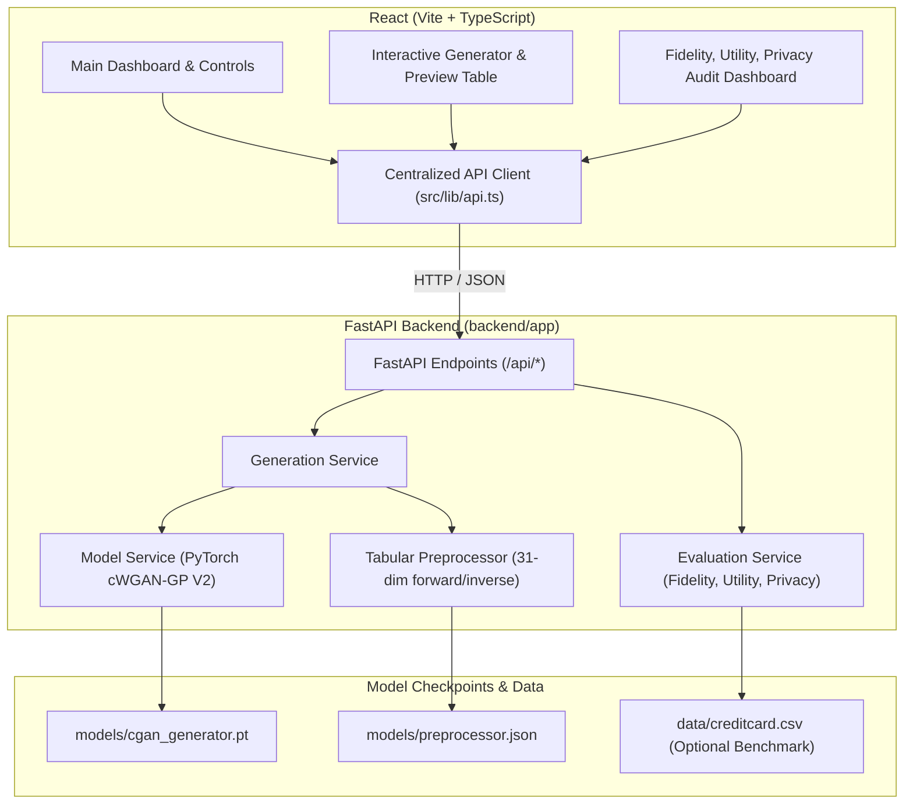

# Tabular Data Synthesizer for Finance Using Conditional Generative Adversarial Network (cGAN)

An end-to-end full-stack machine learning application for synthesizing financial credit card transaction records for fraud detection research while safeguarding real customer identity and original transaction data.

Built with a **React + TypeScript + Tailwind CSS** frontend and a **FastAPI + PyTorch** machine learning backend.

---

## 1. System Architecture



---

## 2. Key Features

- **Conditional Synthesis**: Generate transactions conditioned on requested fraud proportions ($0\%$ to $100\%$) and 4-tier amount distributions.
- **Trained Neural Inference**: Powered by a Conditional Wasserstein GAN with Gradient Penalty (`cWGAN-GP V2`), featuring 2 residual blocks with 256 units and 31 continuous output features.
- **Statistical Fidelity Audit**: Live two-sample Kolmogorov-Smirnov (KS) distance tests across all features and correlation matrix Frobenius norm difference.
- **Machine Learning Utility (TSTR)**: Train-on-Synthetic, Test-on-Real evaluation computing AUPRC, ROC-AUC, Recall, and F1 on an untouched test split.
- **Privacy Assessment**: Distance to Closest Record (DCR) analysis against training vs holdout sets, plus exact replica count verification.
- **Transparent Execution**: Strictly distinguishes genuine neural cGAN inference from statistical simulations or missing checkpoints.
- **Deterministic Reproducibility**: Controlled pseudo-random seed generation for reproducible experiments.
- **CSV Data Streaming**: Export generated tabular datasets directly from backend memory.

---

## 3. Technology Stack

### Frontend
- **Framework**: React 18 with TypeScript
- **Bundler & Tooling**: Vite 7
- **Styling**: Tailwind CSS with custom navy & teal palette
- **Icons**: Lucide React
- **HTTP Client**: Centralized Fetch API client with timeout and connection handling

### Backend
- **Framework**: Python 3.10+, FastAPI, Uvicorn
- **Machine Learning**: PyTorch 2.14 (CPU & CUDA auto-detection)
- **Data & Statistics**: NumPy, pandas, scikit-learn, SciPy
- **Serialization**: joblib, JSON
- **Testing**: pytest

---

## 4. Model Architecture & Preprocessing

### Generator Specifications
- **Input Dimension**: $133$ ($128$ Gaussian noise dims $+ 5$ condition dims: $1$ binary Class $+ 4$ Amount quartiles)
- **Hidden Layers**: Initial Linear projection to $256$ units $\to$ $2$ Residual Blocks ($256$ units, LayerNorm, LeakyReLU $\alpha=0.2$, skip connection)
- **Output**: Linear projection to $31$ units with $\tanh$ activation (range $[-1, 1]$)

### Critic (Discriminator) Specifications
- **Input**: Concatenation of $31$ features and $5$ condition dims (with PacGAN packing support)
- **Objective**: Wasserstein loss with gradient penalty ($\lambda = 10.0$)

### 31 Feature Representation
1. `V1` through `V28`: 28 continuous PCA components scaled to $[-1, 1]$.
2. `Amount`: Log-transformed $\log_{1p}(\max(0, \text{Amount}))$ normalized to $[-1, 1]$.
3. `Time`: Cyclic 24-hour sinusoidal encodings $\sin(2\pi \cdot \text{Hour} / 24)$ and $\cos(2\pi \cdot \text{Hour} / 24)$.

Inverse transformation safely reconstructs `Time` in seconds, non-negative monetary amounts in dollars, standard PCA values, and integer Class labels.

---

## 5. Quickstart & Local Development

### Prerequisites
- Python 3.10 or higher
- Node.js 18+ and npm

---

### Step 1: Start the Python Backend

```bash
# 1. Navigate to backend directory
cd backend

# 2. Create and activate virtual environment
python -m venv .venv

# On Windows PowerShell:
.venv\Scripts\Activate.ps1
# On Linux / macOS:
source .venv/bin/activate

# 3. Install Python dependencies
pip install -r requirements.txt

# 4. (Optional) Run rapid smoke-test training to create trained generator weights:
python training/train.py --smoke-test

# 5. Start FastAPI server
python -m uvicorn app.main:app --host 127.0.0.1 --port 8000 --reload
```
The backend API is now running at `http://127.0.0.1:8000`. API docs: `http://127.0.0.1:8000/docs`.

---

### Step 2: Start the React Frontend

Open a new terminal in the project root:

```bash
# 1. Install frontend dependencies
npm install

# 2. Start the Vite development server
npm run dev
```
Open your browser at `http://localhost:5173`. The navigation bar will indicate `API Connected`.

---

## 6. Model Training Commands

### Smoke-test Mode (Runs immediately without external data)
```bash
python backend/training/train.py --smoke-test
```
Generates 500 benchmark transactions, trains for 2 epochs, and exports `backend/models/cgan_generator.pt`.

### Full Training with Real Benchmark Dataset
1. Download `creditcard.csv` from [Kaggle Credit Card Fraud Detection](https://www.kaggle.com/datasets/mlg-ulb/creditcardfraud).
2. Place the file at `backend/data/creditcard.csv`.
3. Run training:
```bash
python backend/training/train.py --dataset backend/data/creditcard.csv --epochs 25 --batch-size 64
```

---

## 7. API Endpoints

| Method | Endpoint | Description |
|---|---|---|
| `GET` | `/api/health` | Health status, device (CPU/CUDA), and model availability |
| `GET` | `/api/model/info` | Architecture specifications, latent/condition dims, schema |
| `GET` | `/api/dataset/info` | Benchmark dataset status without revealing raw records |
| `POST` | `/api/generate` | Generates synthetic transactions with exact fraud proportions |
| `GET` | `/api/generations/{id}` | Retrieves a previously generated dataset |
| `GET` | `/api/export/{id}` | Streams CSV file download of generated transactions |
| `POST` | `/api/evaluate` | Computes live Fidelity (KS), Utility (TSTR), and Privacy (DCR) |
| `GET` | `/api/evaluation/{id}` | Retrieves persisted evaluation run |

---

## 8. Running Automated Tests

Run backend tests using pytest:
```bash
python -m pytest backend/tests -v
```

Run frontend typechecking and production build:
```bash
npm run typecheck
npm run build
```

---

## 9. Limitations & Privacy Considerations

1. **Synthetic Nature**: Synthetic data preserves statistical distributions and correlation structure, but does not represent actual cardholders or specific merchants.
2. **Differential Privacy**: Empirical checks (such as distance-to-closest-record $DCR > 0$) confirm the absence of direct memorization, but do not provide a formal differential privacy guarantee ($\epsilon, \delta$).
3. **Extreme Imbalance**: Real benchmark fraud accounts for only $0.172\%$ (492 of 284,807 transactions). Model performance depends heavily on conditioning and sampling strategies.
4. **Anonymized PCA**: Features `V1`–`V28` are PCA components from the original dataset and do not expose unhashed card details.
